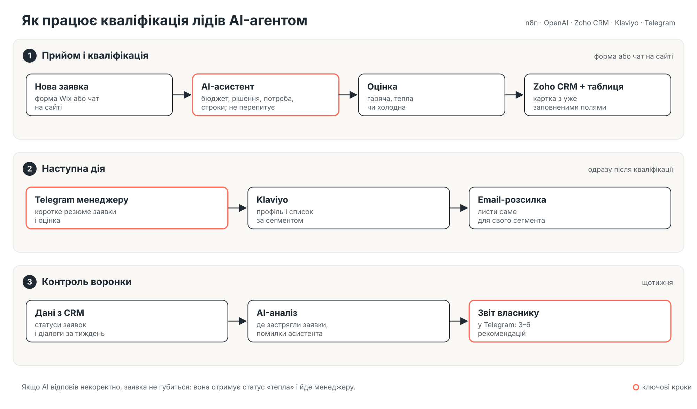
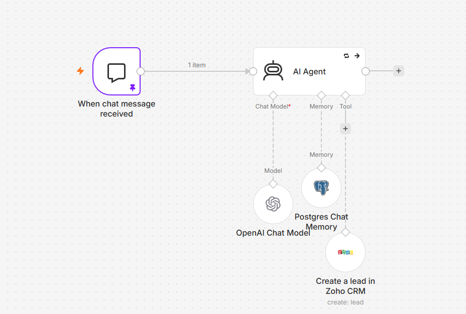
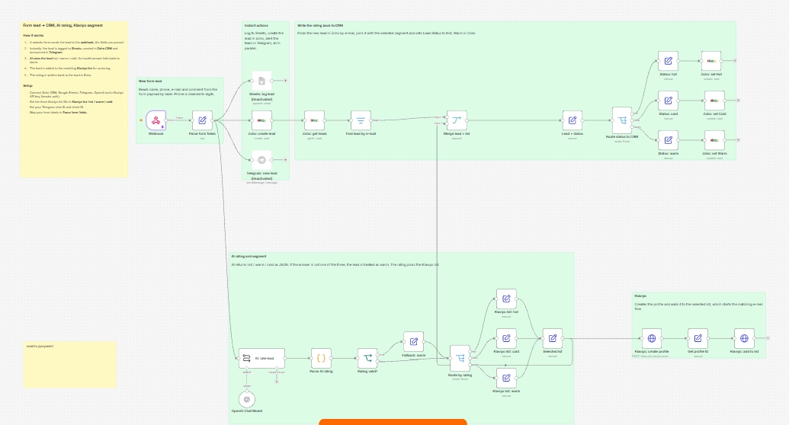
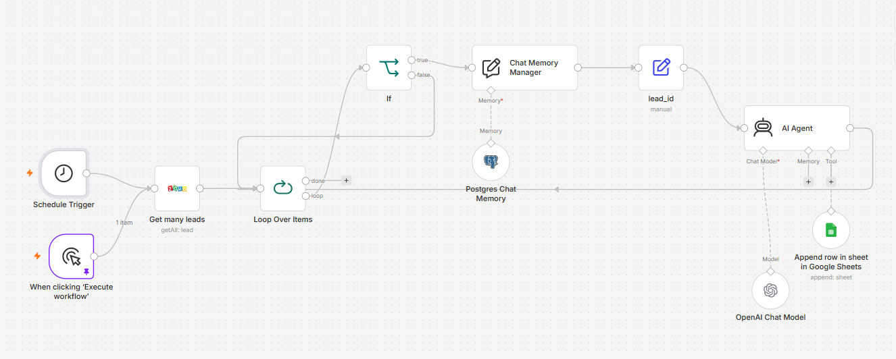
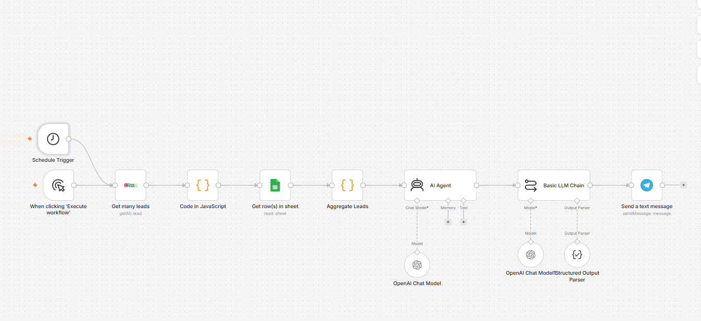
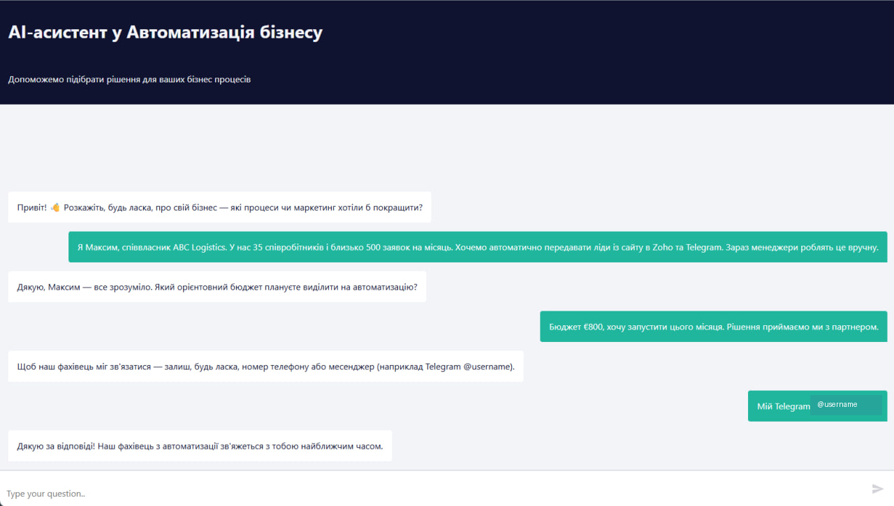
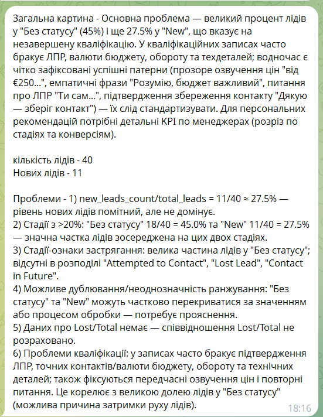

# AI Lead Qualification Agent, CRM Sync & Klaviyo Segmentation

**From the first message to a manager's next action: an AI agent qualifies the lead, the CRM card fills itself, the contact lands in the right e-mail segment and the owner sees where the funnel gets stuck.**

Demo project by Procesto, built and tested on test data. Good fit for consulting, relocation and legalization agencies, and online schools.

## The problem

> "We have enough inquiries, but some get lost: someone gets a reply a day later, someone gets the wrong manager, and half of the CRM cards are empty."

- Inquiries from the form, chat and messengers land in different places.
- A manager reads each one by hand and decides who is "hot".
- CRM data is copied manually: cards are incomplete or late.
- Everyone gets the same e-mails, whatever their readiness to buy.
- The owner cannot see where the funnel gets stuck.

## What the system does

1. **One entry point.** An inquiry from the website form or chat goes straight into a single process.
2. **AI qualification.** The assistant holds a short conversation and finds out budget, decision-maker, need and timeline (BANT). It never asks again what the client already said.
3. **Score and CRM card.** The lead is rated hot, warm or cold and lands in Zoho CRM with the fields filled in and a short reason for the score.
4. **Instant alert.** The manager gets a summary in Telegram right away.
5. **Segmented e-mails.** The contact joins the Klaviyo list for its segment.
6. **Funnel control.** Every day AI reviews the qualification dialogues: assistant mistakes, real client needs, phrases that worked. Every Friday the owner gets a funnel report with 3–6 recommendations.

If the AI answer cannot be read, the lead is not lost: it is marked warm and goes to a manager.

## Before / after

|  | Before | After |
| --- | --- | --- |
| Where inquiries are | in different places | in one process and in the CRM |
| Who sets priority | a manager, by hand | AI by your rules; the manager sees why |
| CRM card | hit or miss | key fields filled automatically |
| Manager reaction | whenever they notice | alert right after the inquiry |
| E-mail campaigns | the same for everyone | by segment |
| Funnel control | manual | weekly report |

## Under the hood

Four n8n workflows:

- **Chat qualification agent:** AI Agent with dialogue memory in PostgreSQL, BANT scoring 0–100, Zoho CRM tool.
- **Form intake and segmentation:** webhook → Zoho + Google Sheets + Telegram → AI rating → Switch → Klaviyo profile and list → status back to Zoho.
- **Daily dialogue review:** reads each chat by the session ID saved on the lead → AI analysis → Google Sheets.
- **Weekly funnel report:** Zoho leads + dialogue reviews → JavaScript aggregation → AI analysis with a structured output → Telegram.

**Stack:** n8n · OpenAI · Zoho CRM · Klaviyo API · Telegram Bot API · Google Sheets · PostgreSQL

## Screenshots

| Chat qualification agent | Form intake & segmentation |
| --- | --- |
|  |  |
| **Daily dialogue review** | **Weekly funnel report** |
|  |  |

The website chat in a test conversation:

A weekly funnel report in Telegram, generated from test data:

## Workflow files

The four workflows are in [`workflows/`](workflows) with **prompts removed** and every credential, ID and test record stripped. You can see the full architecture: nodes, routing, code, error handling, Zoho and Klaviyo calls.

## Get the full workflow

The prompts and the setup guide are not published. To see the system running on a call, or to get it set up for your CRM and your qualification rules:

→ **[Fill in a short brief](https://tally.so/r/J1lLxK?utm_source=github&utm_medium=repo&utm_campaign=portfolio&utm_content=ai-lead-qualification)** · [Full case study with video](https://super-kettle-5ea.notion.site/41d396519ffa81808037e88a1b791043) · [procesto.eu](https://procesto.eu)

---

© 2026 Procesto. All rights reserved. The workflow files are shared for evaluation only; reuse requires written permission.
